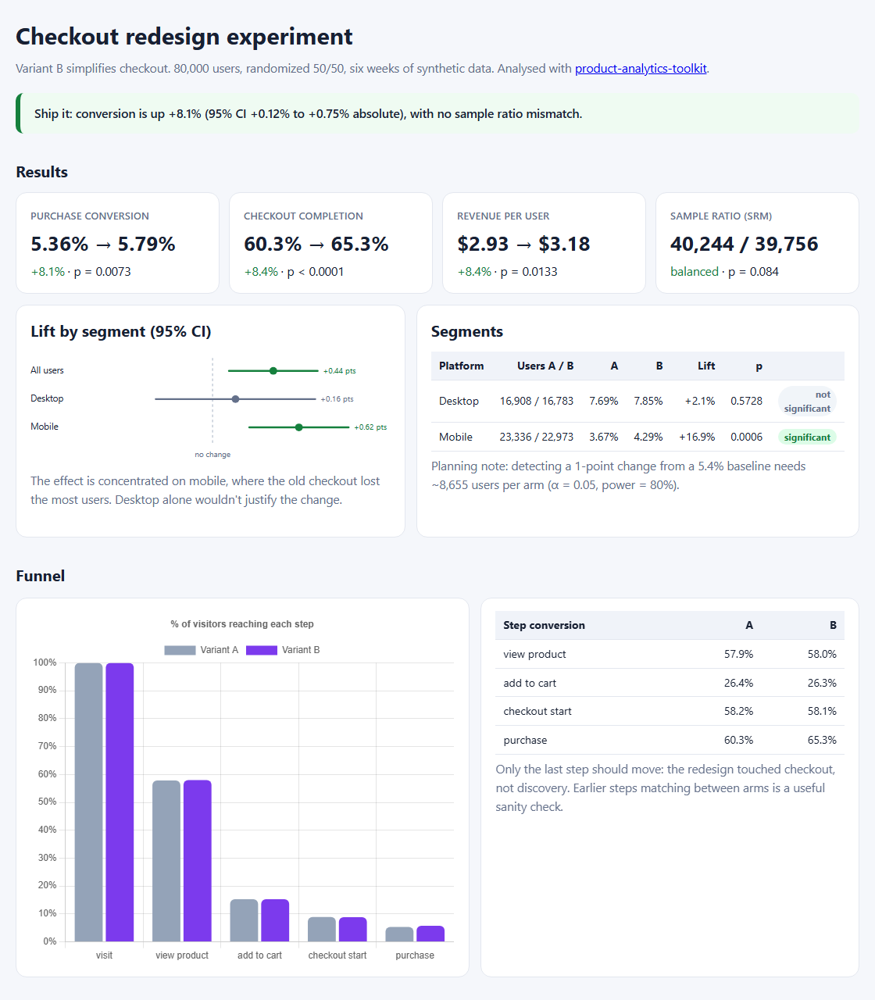

# product-analytics-toolkit

**A/B tests, funnels and cohort retention with zero dependencies, plus a one-command experiment dashboard.**

<p>
  <a href="https://mgupta646.github.io/product-analytics-toolkit/"></a>
  <a href="https://github.com/mgupta646/product-analytics-toolkit/actions/workflows/ci.yml"></a>
  
  
</p>

<a href="https://mgupta646.github.io/product-analytics-toolkit/"></a>

## The demo: a checkout redesign, tested properly

In an NYU Operations Management case on retail process strategy, my team proposed a **DMAIC-based checkout redesign** with quality KPIs like payment success and payment time. This project asks the next question a product team would: **how do you prove the redesign worked?**

`pakit demo` simulates a 6-week, 80,000-user experiment (synthetic and seeded) and analyses it the way I'd want it reviewed:

1. **Check the split first.** A sample-ratio-mismatch (SRM) test runs before anything else. If assignment is broken, the verdict is *don't ship*, whatever the lift looks like.
2. **Primary metric with a confidence interval:** purchase conversion 5.36% → 5.79% (**+8.1%, p = 0.007**, 95% CI +0.12 to +0.75 pts).
3. **Mechanism check:** only the checkout step moved (60.3% → 65.3%). Upper-funnel steps match between arms, as they should for a checkout-only change.
4. **Segments:** the effect is concentrated on **mobile (+16.9%, p = 0.0006)**; desktop alone is not significant. That's a product insight, not just a p-value.
5. **Revenue per user and retention** as secondary and guardrail views.
6. **Planning:** the sample size needed for a 1-point change, so "keep running" has a number attached.

## Use it

```bash
git clone https://github.com/mgupta646/product-analytics-toolkit && cd product-analytics-toolkit
pip install -e ".[dev]"

pakit demo                                              # simulate + build docs/index.html
pakit abtest --control 1200/10000 --variant 1290/10000  # two-proportion z-test with CI
pakit samplesize --baseline 0.12 --mde 0.01             # users per arm (α=0.05, power=0.8)
pakit srm --counts 52000 48000                          # sample ratio mismatch alarm
```

```
control 12.0000% · variant 12.9000% · lift +7.50%
diff +0.9000% (95% CI -0.0150% to +1.8150%) · z = 1.928 · p = 0.05391 · not significant
17,169 users per arm (34,338 total) to detect 12.00% → 13.00%
chi2 = 64.00 · p = 0.000000 · SAMPLE RATIO MISMATCH: investigate before reading results
```

As a library, pass any event log (`user_id`, `event`, `ts`, plus segment columns):

```python
from pakit import analyse, funnel, retention, load_csv

events = load_csv("events.csv")
res = analyse(events, control="A", variant="B", goal="purchase", segment="platform")
print(res.verdict)
funnel(events, ["visit", "view_product", "add_to_cart", "checkout_start", "purchase"], segment="variant")
retention(events, period_days=7, periods=6)
```

## What's inside

| Module | Methods |
|---|---|
| `stats.py` | two-proportion z-test (pooled SE for the test, unpooled for the CI) · Wilson interval · Welch z-test for means · sample size for a target MDE · SRM chi-square · inverse normal (Acklam + Newton step) |
| `events.py` | **ordered** funnels (a step only counts if the previous one happened first) · weekly cohort retention |
| `experiment.py` | SRM-gated analysis, segment breakdowns and a plain-English verdict |
| `dashboard.py` | static HTML dashboard: forest plot (inline SVG), Chart.js funnel, retention heatmap |
| `simulate.py` | seeded synthetic event log with a known, platform-dependent treatment effect |

**Correctness:** the tests check the statistics against **SciPy reference values** (to 1e-9 for z-tests, quantiles and chi-square), check that the sample-size formula achieves 80% power, and check that the pipeline recovers the effect planted in the simulation (mobile significant, desktop not) and refuses to ship when SRM is injected.

## Notes

- Fixed-horizon tests assume you decide the sample size up front and don't stop early when p dips below 0.05. Use the `samplesize` command before launching.
- The z-approximation for means is appropriate at product-experiment scale (thousands per arm). For small samples, use a t-test.

---

<sub>Built by <b>Mehul Gupta</b> · <a href="https://mgupta646.github.io/">Portfolio</a> · <a href="https://www.linkedin.com/in/mehulmg/">LinkedIn</a></sub>
